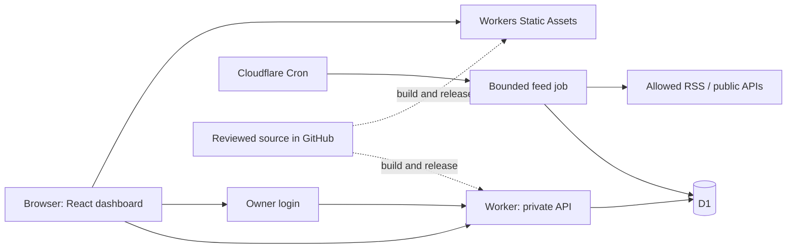

# Dashboard Plan B: Cloudflare feasibility and salvage

Checked: 2026-10-16. Research and proposed architecture only.

## Decision and authority

The owner has changed direction from Muse hosting to Cloudflare and asked
for research before implementation. This supersedes the former host
preference. It does not pass a release gate or authorize a private-data
migration. Keep Muse and Jules implementation work on hold. Preserve all
existing branches, files and evidence. Do not finish an unrelated validator
cycle as a condition for starting this plan.

The target is a private dashboard with automatic public-source updates and
a durable backend. Pages, login, reads, saves and scheduled feed processing
must work without an active AI conversation. Required additional service
cost remains $0. Keep personal context out of source, relay material and
public queries. Use invented records during development and host tests.

## Recommendation

Use **Workers Static Assets + one TypeScript Worker + D1 + Cron Triggers**.
Use a free `workers.dev` address initially. Keep frontend, API and login on
one origin. Use React as a static browser application. Server-side rendering
is unnecessary for this private dashboard.

Cloudflare recommends Workers with Static Assets for new applications.
Workers can start without a credit card. The account's actual eligibility
and selected products have not been inspected. A personal `workers.dev`
address avoids a domain purchase. These facts support feasibility, not an
unlimited-service or permanent-price promise.
[Workers](https://www.cloudflare.com/products/workers/),
[Static Assets](https://developers.cloudflare.com/workers/static-assets/),
[workers.dev](https://developers.cloudflare.com/workers/configuration/routing/workers-dev/)

GitHub stores source and supports reviewed releases. It is not part of the
normal page or save path. No Muse SDK, Muse agent invocation, ChatGPT API,
or inference service is required at runtime. AI-assisted coding remains a
development activity.

Two alternatives were considered. Workers with external Turso could retain
more of the existing libSQL adapter, but adds another service, credentials,
network boundary and independent free policy. A static site plus GitHub
Actions data files has fewer backend components, but does not supply private
durable goal writes or a complete login/backend. Neither is the preferred
baseline for the full dashboard.

## Free limits that affect the design

| Resource | Current Free limit |
|---|---:|
| Worker invocations | 100,000/day per account |
| HTTP and Cron CPU | 10 ms per invocation |
| Worker memory | 128 MB |
| External subrequests | 50 per invocation |
| Cron schedules | 5 per account |
| D1 rows read / written | 5 million / 100,000 per day |
| D1 storage | 5 GB per account; 500 MB per database |
| D1 Time Travel | 7 days |
| Workers Builds | 3,000 minutes/month; one concurrent build |

Network/database waiting does not consume Worker CPU. Cron's 15-minute
wall-time allowance does not increase its Free CPU allowance. Parsing,
validation, cryptography and response construction still need measurement.
[Workers limits](https://developers.cloudflare.com/workers/platform/limits/),
[D1 limits](https://developers.cloudflare.com/d1/platform/limits/),
[Build limits](https://developers.cloudflare.com/workers/ci-cd/builds/limits-and-pricing/)

D1 counts scanned rows, not just rows returned. Index maintenance also
consumes writes and storage. Daily Free D1 quotas reset at 00:00 UTC; their
exhaustion blocks queries. Storage exhaustion blocks relevant writes. These
are shared account allowances. Add indexes and inspect actual query metadata.
[D1 pricing](https://developers.cloudflare.com/d1/platform/pricing/)

Direct asset serving is free; invoking a Worker for an asset consumes its
request allowance. `run_worker_first` does not provide an asset fallback
after exhaustion. The newer Workers Caching feature has a specific request
charging exception, including assets. Keep it disabled in the baseline.
This does not mean disabling the ordinary asset delivery cache.
[Asset billing](https://developers.cloudflare.com/workers/static-assets/billing-and-limitations/),
[Workers pricing](https://developers.cloudflare.com/workers/platform/pricing/)

Use Free products explicitly. Do not activate Workers Paid, R2 checkout,
inference, a paid fallback or a custom-domain purchase. Quota exhaustion is
an outage to report, not permission to upgrade. An application counter
cannot guarantee that the platform will keep executing the application.

Documentation differences need care: D1's per-invocation table says 50 Free
queries while current Workers guidance distinguishes larger internal-service
subrequest limits. Design below 50 D1 calls until actual binding/batch
accounting is verified. Generic 10 GB database / 30-day backup prose must
not replace the Free-specific 500 MB / seven-day limits.

## Login decision

**Recommended no-Zero-Trust-onboarding option: GitHub OAuth for one owner.**
Use authorization code, single-use state and PKCE S256. Obtain authenticated
`GET /user` and allow exactly the configured numeric account ID. Request no
repository or email scopes. A username change must not change authority.
Keep the client secret on the server. Discard the GitHub token after identity
lookup if there is no other GitHub integration. Store dashboard session
verifier hashes, expiry and revocation in D1, with a secure HttpOnly cookie.
Keep API origin and CSRF controls. These are proposed controls, not existing
code or a fresh auth test.
[OAuth flow](https://docs.github.com/en/apps/oauth-apps/building-oauth-apps/authorizing-oauth-apps),
[Stable identity](https://docs.github.com/en/apps/oauth-apps/building-oauth-apps/best-practices-for-creating-an-oauth-app),
[User endpoint](https://docs.github.com/en/rest/users/users#get-the-authenticated-user),
[Scopes](https://docs.github.com/en/apps/oauth-apps/building-oauth-apps/scopes-for-oauth-apps)

The documented GitHub account/app flow needs no additional authentication
subscription. This is not a promise that any vendor's policy will stay
unchanged. Existing account MFA/recovery stays with the provider. Do not
build a separate password-reset/TOTP system merely to reproduce the former
Muse login.
[GitHub pricing](https://github.com/pricing),
[OAuth registration](https://docs.github.com/en/apps/oauth-apps/building-oauth-apps/creating-an-oauth-app)

Alternative: **Cloudflare Access Free** reduces app-owned login work. Its
Zero Trust setup currently requests payment details even for Free. It is
therefore not an unconditional no-card recommendation. Worker-level Access
with All traffic protects routes, `workers.dev`, assets and previews. Use an
exact owner policy. Account membership alone is too broad if collaborators
join. The Cloudflare IdP can use account MFA.
[Zero Trust setup](https://developers.cloudflare.com/cloudflare-one/setup/),
[Access for Workers](https://developers.cloudflare.com/workers/configuration/cloudflare-access/),
[Cloudflare IdP](https://developers.cloudflare.com/cloudflare-one/integrations/identity-providers/cloudflare/)

An Access implementation must verify the API JWT's signature, issuer,
audience, expiry and owner. Do not trust an email header or assume
`ctx.access` exists through the asset router. Test redirect/session behavior
on mobile as well as desktop.
[JWT verification](https://developers.cloudflare.com/cloudflare-one/access-controls/applications/http-apps/authorization-cookie/validating-json/),
[Asset routing](https://developers.cloudflare.com/workers/static-assets/routing/worker-script/)

For app-owned login, a generic public shell with no personal records and
authenticated private APIs is a valid lower-cost proposal. Fully private
HTML/assets instead need complete Worker routing and count those asset
requests. Do not embed records, owner identifiers, credentials or private
configuration in static files. This privacy/routing choice needs one clear
decision in the new design.

The old Node scrypt implementation and process-local session Map are not
the new authority. Isolates can be replaced and requests can reach different
instances. Per-process throttles and concurrency limits are not global.
[Execution model](https://developers.cloudflare.com/workers/reference/how-workers-works/)

## Database adaptation

D1 is a SQLite-based service, but it is not the libSQL client. Adapt the
boundary and result/error shapes deliberately. Node compatibility does not
provide a durable local SQLite file. `node:sqlite` is documented as a stub;
the Workers filesystem is memory based.
[Node compatibility](https://developers.cloudflare.com/workers/runtime-apis/nodejs/),
[Filesystem](https://developers.cloudflare.com/workers/runtime-apis/nodejs/fs/)

D1 documents ordered transactional batches and rollback of the whole sequence
when a statement fails. It does not document the existing interactive
JavaScript transaction shape. A successful statement that affects zero rows
does not itself cause rollback. Retain SQL precondition assertions, the
mutation, dataset version and immutable operation receipt in one atomic
batch. Re-prove affected-row checks and actual constraint behavior on D1.
[D1 Database API](https://developers.cloudflare.com/d1/worker-api/d1-database/)

Preserve the existing contract invariants: complete request validation,
generation/revision checks, exact idempotent replay and an unknown outcome
after an interrupted write response. Never turn a timeout into an invented
rollback. Adapt libSQL-specific error classes rather than hiding them behind
type casts. Verify date/JSON/trigger/BLOB/text behavior, including malformed
UTF-8 and embedded NUL cases relevant to the current contract.

Start with primary reads and the existing coherent-read invariant.
Sequential consistency is not a multi-table snapshot. If read replication is
later used, carry D1 session/bookmark semantics across relevant requests.
[Read replication](https://developers.cloudflare.com/d1/best-practices/read-replication/)

Keep goal data, goal history, operation receipts and public feed cache in
separate logical tables with explicit budgets. The old 1 MiB / 1,000-record
transfer limit is an app contract, not D1's capacity. Receipts currently grow
outside it. Define retention/admission before growth becomes a fault. Do not
delete immutable receipts and silently break replay to make space.

## Automatic updates without an AI loop

Use Cron's `scheduled()` handler with direct D1 bindings. No public refresh
endpoint or AI-agent invocation is required. Store job identity, cursor,
attempt/success times, safe error and next-due time. Treat a schedule as a
wake-up, not proof of success. Repeated wakes must be harmless and later
ticks must recover unfinished work.
[Scheduled handler](https://developers.cloudflare.com/workers/runtime-apis/handlers/scheduled/)

Cron uses UTC; configuration can take 15 minutes to propagate. The reviewed
production pages do not establish exact-minute dispatch, a retry count or
exactly-once delivery. Do not transfer promises from Workflows or Durable
Object alarms to ordinary Cron. Use the saved dashboard time zone for goal
windows; do not derive a daily goal deadline from a UTC cron timestamp.
[Cron configuration](https://developers.cloudflare.com/workers/configuration/cron-triggers/)

Proposed small-job baseline: one wake every five minutes, at most one due
feed per invocation. That provides 288 opportunities/day and up to 12
sources/hour if each takes one tick. Begin with fewer sources. Proposed
limits are a 128 KiB response body, 25 normalized items, bounded redirects,
timeouts and approved HTTPS destinations. These are design inputs for a
CPU probe, not established safe sizes. The byte cap must apply to the body
actually read, including decoded content. Avoid regex-only structural parsing.

Use conditional requests when the source supports them. Deduplicate stable
IDs/links. Update only changed records. An invalid document must not become
a successful empty feed. Preserve the last complete cache. Show source,
publication time, observation time where different, last successful fetch,
and stale/error state. Keep exchange-rate series dates separate.

If a permitted feed cannot fit the measured Free CPU budget, reduce or split
that work. If it still cannot fit, use a separately reviewed GitHub Actions
collector as a fallback. This is not an automatic architecture expansion.
GitHub Free includes 2,000 private-repository runner minutes/month, shared
across account use. A 31-day hourly job billed at one minute/run is 744
minutes; at three minutes/run it is 2,232 and exceeds that allowance before
tests. Schedule dispatch can be delayed or dropped. Do not call it guaranteed
hourly service.
[Actions billing](https://docs.github.com/en/billing/concepts/product-billing/github-actions),
[Scheduled events](https://docs.github.com/en/actions/reference/workflows-and-actions/events-that-trigger-workflows#schedule)

Source adapters must follow the source's API/feed terms and show attribution.
Retain the previously reviewed Bank of Canada first-source candidate. Verify
its current terms and the actual adapter before release; do not reopen that
preference without a technical reason. A rates/indicator card does not by
itself complete the requested news module. Add a permitted news source as
its own bounded adapter when Updates expands.
An available RSS URL does not grant a universal full-article republication
licence. News display and rules-based relevance do not need an LLM. Optional
AI summaries or recommendations are separate features with separate cost,
privacy and accuracy requirements. Do not promise automated personalized
legal or investment judgments from a feed list.

## Illustrative budget model

The accompanying [model](COST-MODEL-2026-10-16.json) contains explicit invented
assumptions. It is arithmetic, not a performance or account test. It counts
20 opens/day at six API calls, 40 saves at two calls, and 288 scheduled wakes.

| Polling assumption | Estimated invocations/day |
|---|---:|
| One tab, two hours, 60-second refresh | 608 |
| One tab, 24 hours, 60-second refresh | 1,928 |
| Ten tabs, 24 hours, 60-second refresh | 14,888 |
| One tab, 24 hours, one-second refresh | 86,888 |
| Two tabs, 24 hours, one-second refresh | 173,288 |

Use refresh on open, after writes and at a moderate interval while visible.
Pause polling in hidden tabs, deduplicate across tabs where practical, and
use backoff. Continuous one-second polling is unnecessary for this product.

For a deliberately pessimistic small feed example, 288 wakes × 25 changed
items × an assumed three written-row units, plus checkpoint and save writes,
gives 22,656 written rows/day. Actual index/query accounting must replace the
assumption. Retaining 10,000 items at 3 KiB each, doubling for indexes/overhead,
plus explicit record/history/receipt reserves gives about 94 MB. This does
not authorize storing unlimited history or articles. A full-table scan can
exhaust read allowances even with few returned rows.

The main unknown is CPU, not this request arithmetic. Measure API validation,
auth, normal saves, conflicting saves and worst permitted feed documents in
the actual Workers runtime. Local tests support correctness but do not prove
host CPU behavior.

## What to salvage

Use portable source at **PR #18 / b029cc002dcbe8b91e39b3c32137dffcd05d93b4**
as the correctness starting point. It is open and unmerged. Its historical
report records 87 checks and seven browser cases on Node/local libSQL.
Those tests were not rerun in this research, and they do not pass Cloudflare.
[Portable source](https://github.com/lullabie/dashboard/tree/b029cc002dcbe8b91e39b3c32137dffcd05d93b4/implementation/portable-dashboard),
[Recorded local review](https://github.com/lullabie/dashboard/blob/b029cc002dcbe8b91e39b3c32137dffcd05d93b4/docs/stage-2a/PORTABLE-SOURCE-REVIEW-2026-10-14.md)

| Material | Disposition |
|---|---|
| `shared/goals-contracts.ts` | Retain strict rules; deliberately extend the old manual-goal model |
| `client/src/goals/state.ts`, `client/src/api.ts` | Retain state epochs, frozen retries, draft/conflict/error behavior; adapt auth |
| Browser shell, editor/list and CSS | Retain useful interactions and accessibility; apply current black/lime preference |
| Canonical serialization, capacity and safe errors | Mostly reusable after neutral types/imports |
| Save/batch/snapshot/stored-text algorithms | Retain invariants; replace libSQL binding and prove D1 behavior |
| SQL schema and test scenarios | Candidates for D1 adaptation, not unchanged acceptance evidence |
| Node server, scrypt/Map sessions, startup/config and DB-budget wrapper | Replace for Workers and durable auth |
| Exact Muse source in `audit/source/` at `9eaf20de6b7770ce82671385b545bac31de72d0d` | Design/calendar-helper reference; do not port backend wholesale |
| Old feed package | Reuse reviewed adapter/parser ideas; remove private SDK and correct failure/date/bounds defects |

The portable snapshot makes seven SQL calls per coherent snapshot attempt;
a normal fresh save has 17 SQL statements before retry. This static count
is a reason to measure and reduce unnecessary work while retaining safety.
It is not a D1 billing measurement.

The newer Muse source offers black/lime cards and daily UI examples, but its
backend lacks the portable assertion/version guarantees. It can insert a
receipt after a zero-row conditional update. Its check-in identity does not
bind the resolved occurrence; retry across midnight can change the target
day if no prior receipt exists. It persists drafts in localStorage and a
bearer token in sessionStorage. Do not copy these as accepted behavior.
[Exact source locator](https://github.com/lullabie/dashboard/tree/9eaf20de6b7770ce82671385b545bac31de72d0d/audit/source)

Portable runtime imports do not require the private Muse SDK. The original
old feed/Muse packages do. The dependency licence review checked direct
packages only. Preserve upstream notices and provenance; do not create a
public repository or invent a licence for the application source.

## Product scope retained

The first screen still answers Today. Goals and Updates remain one view
change away. Use compact black surfaces, lime accents, labeled visuals and
expandable records/modules. An expansion shows usable content plus distinct
source/freshness/connection details.

| Area | Retained purpose |
|---|---|
| Today / calendar | Upcoming, important and urgent work; schedules and deadlines |
| Goals | Quick daily check-in, fixed daily window, red missed-day bar, preferred time, measured units, history and discipline |
| Updates / news | Global and country feeds, source attribution, deduplication and freshness |
| Immigration updates | Public policy/program, employer/employee and opportunity categories; later private relevance rules |
| Finance / economy | Economy, growth, banking and public indicators with their true observation dates |
| Investment research | Watchlists and research connections; no trade execution or invented recommendations |
| Jobs / opportunities | Postings, demand, local/remote events, networking and opportunities from permitted sources |
| Education | Timetable, assignments, projects, attendance and events; private source access is a later decision |
| Offers / deals | Student offers, price history, alerts and lowest-price views for supported sources |
| Weekly reviews | Review progress; confirm proposals into durable commitments and milestones |
| Quick Feed | Visual carousel with categories, importance ordering and per-story expansion, using the Updates ingestion pipeline |

Neither existing app implements this full table. Do not rename goal history
to Updates or equate an empty placeholder with a completed module.

Daily-goal design must separate achievement, check-in adherence and elapsed
time. Do not let a percentage drag fabricate completed days. Preserve the
selected simple rule: a calendar day in the saved dashboard zone closes at
the next local midnight. Preferred task time is separate from that cutoff.
Clock-change days can have 23 or 25 hours but remain one daily occurrence.

Only eligible scheduled days count. Pre-start and recorded paused periods
are not missed. Later pauses or edits cannot erase closed gaps. A late entry
remains late; label a missing on-time record Missed check-in, which does not
assert the activity was not performed. A cumulative quantity goal can finish
early; do not cap genuine achievement by elapsed time. A generic Done tick
must not invent a measured quantity. Preserve visible correction history.

Bind check-in identity to an occurrence and schedule version. Define partial-
day pauses, inclusive/exclusive end dates, travel, target changes and effective
dates. Structured quantity/unit and full history need a reviewed DTO extension;
the portable schema does not already provide them. These rules continue the
[recorded daily design](https://github.com/lullabie/dashboard/blob/b029cc002dcbe8b91e39b3c32137dffcd05d93b4/docs/design/MUSE-VIDEO-REVIEW-2026-10-15.md).

## Build order and visible results

1. **One small compatibility proof:** owner-authenticated Worker/D1 read and
   save, atomic receipt/rollback and a bounded scheduled source update. Use
   invented records. Measure CPU and D1 counters. Keep it focused on the
   risks that can invalidate the hosting choice.
2. **First usable release:** Today, working Goals and an actual Updates feed
   on one address. Include reload persistence, a clear source failure state
   and mobile/keyboard behavior. This must show a real new feed, not another
   goal-only mockup.
3. **Daily goals:** occurrence-safe quick Done, time/units, missed windows and
   full history, with honest progress and pause rules.
4. **Updates expansion:** add permitted immigration, news and economy adapters
   incrementally. Each adapter needs fixtures, attribution and a visible
   last-success state.
5. **Later domains:** jobs/opportunities, education/calendar, finance research
   and offers/price history. Each keeps its own data/source/permission limit.

This is the proposed sequence, not an approved implementation plan or an
invented completion estimate. First deliver one reviewed design and one
short executable plan. Use Jules only for bounded tasks with a concrete
input, output and acceptance case. Muse is optional reference/review, not a
hosting or coordination dependency. Avoid parallel agents editing the same
files and repeated review loops without a changed testable result.

## Acceptance and operation

Before private records or release: prove owner-only API access, durable
sessions across independent requests/deploys, strict validation, duplicate
and concurrent saves, false-success prevention, actual batch rollback,
coherent read/reload persistence and recovery after a committed response is
lost. Test ineligible/future check-ins separately from generic save tests.

For feeds: prove a later scheduled run updates D1 and the browser with all
AI conversations closed. Test a timeout, 304, invalid XML/JSON, oversized
decoded body, redirect, duplicate tick and stale cached data. Record actual
CPU, scanned/written rows and safe job status. A cron entry is not evidence
of a completed unattended run.

Use local Workers-runtime tests and then a separate invented-data deployment
database. The Cloudflare test integration runs inside the Workers runtime;
local D1 is separate from remote storage.
[Workers tests](https://developers.cloudflare.com/workers/testing/vitest-integration/),
[Local D1](https://developers.cloudflare.com/d1/best-practices/local-development/)

Cloudflare's newer previews and older version URLs have different resource
semantics. Explicitly bind a separate test D1. Preview service bindings can
still reach production; a preview login is not database isolation. Code
rollback does not roll back data.
[Preview isolation](https://developers.cloudflare.com/workers/previews/resources/)

Time Travel is automatic recovery, not an independent off-site backup. Add
an owner export path and a tested restore procedure using invented data.
Local encrypted copies are the initial proposal. A restored database can
resurrect revoked app sessions; invalidate sessions after a restore.
[Time Travel](https://developers.cloudflare.com/d1/reference/time-travel/),
[Import/export](https://developers.cloudflare.com/d1/best-practices/import-export-data/)

Use privacy-safe logs and a compact persistent job-status view. Free Workers
Logs currently has three-day retention. Its page announces a pricing change
from December 1, 2026; do not rely on today's observability terms forever.
Do not log bodies, cookies, OAuth codes, tokens or private goal text.
[Workers Logs](https://developers.cloudflare.com/workers/observability/logs/workers-logs/)

D1 encryption uses provider-managed keys. Hosting private records there is
not end-to-end encryption. Location hints are not jurisdiction guarantees,
and a database jurisdiction does not constrain every log, auth service or
future connector. No private data has been transferred in this research.
[Data security](https://developers.cloudflare.com/d1/reference/data-security/),
[Data location](https://developers.cloudflare.com/d1/configuration/data-location/)

Routine operation can be unattended. Broken upstream feeds, changed vendor
terms, account recovery and code defects can still need maintenance. This
design removes the active-AI dependency; it does not promise a maintenance-
free service or unlimited free external market/news data.

## Clean start and tooling

Preserve `lullabie/dashboard` as the historical source/evidence repository.
Use a minimal reviewed allowlist if a new private repository is created.
Do not clone private-data folders, databases, recordings, screenshots,
credentials, raw partner packets, generated output, dependencies or old Git
metadata into it. Archive old packages and host descriptors outside active
build globs. No new repository is required merely to complete this research.

Official Cloudflare skills `cloudflare` and `workers-best-practices` were
installed from ref `be9f5e1e940fcf8567ff723cc03b8a8448c4082f`, with Apache-2.0
licence and provenance. No MCP/account permissions were added. Existing
GitHub, browser, ECC and review tools remain available. The plugin search
found no Cloudflare plugin in the available catalogue; this does not prevent
later use of Cloudflare's official tools.

The official skill now prefers `cf` for a new project. Current `cf` docs
label it beta; Wrangler remains supported for Wrangler-configured projects.
Choose and pin one project toolchain in the implementation plan, verify the
needed D1/assets/test commands, and avoid a mid-build toolchain migration.
No product CLI or dependencies were installed today.
[Official skills](https://github.com/cloudflare/skills),
[Cloudflare CLI](https://developers.cloudflare.com/cf/)

## Remaining decisions

- Login: GitHub OAuth, or Access Free with the documented payment-details
  requirement. No secrets or account ID should be pasted into chat.
- Generic public shell/private APIs, or access-controlled assets too.
- New private repository name, if desired. Existing repository is preserved.
- Written occurrence/history contract. Retain the Bank of Canada first-source
  candidate; verify current source terms and select a separate permitted news
  source for the news module.

No site, database, OAuth app, billing change, migration, schedule or release
was created by this research. See [new-chat handoff](NEW-CHAT-HANDOFF.md).
