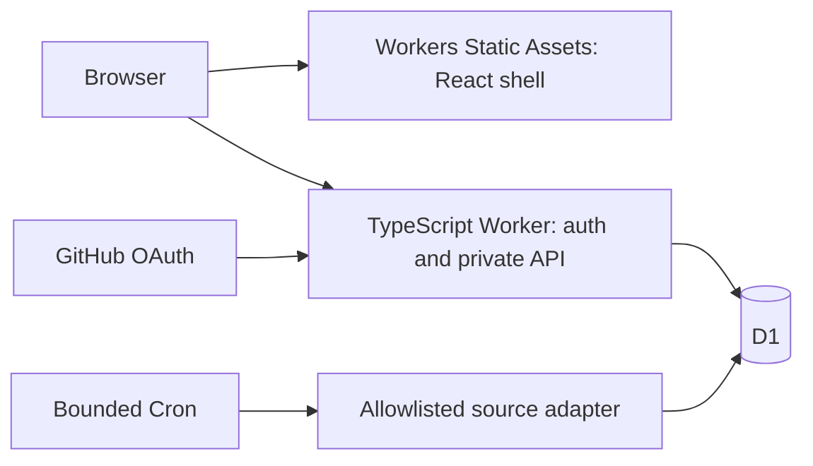

# Dashboard Plan B: design for review

Date: 2026-10-16. Owner: Astra. Status: proposed; implementation not authorized.
Basis: [clean handoff](NEW-CHAT-HANDOFF.md) and [completed research](CLOUDFLARE-RESEARCH-2026-10-16.md), published at `c261da2cb8d56a3a5a219042c8503add416a900f`.
This document resolves design details for review. It does not report new vendor research or runtime results. All examples are invented.

## Outcome and release boundary

Provide one Dashboard address that works with all AI chats closed. Required additional service cost stays $0. Keep compact black surfaces, lime accents, labeled visuals, expandable cards, keyboard access and mobile layouts. Today opens first; Goals and Updates each take one view change. Keep **Show notes on card** as a display preference; hiding notes never deletes them.

| Surface | First usable release R1 | Following increment R2 |
|---|---|---|
| Today | Saved manual goals, due dates and preferred times; overdue/upcoming lists; links to Goals and latest source updates; honest empty/error states | Daily occurrences, missed-window bar and history summaries |
| Goals | Create, edit, archive, restore from archive, notes, explicit manual achievement, durable saves, conflicts and exact retry recovery | Quick daily Done, measured time/units, pauses, correction history and separate adherence |
| Updates | Actual Bank of Canada observations from a bounded scheduled adapter; series-specific dates, attribution, source link and freshness/error details | Separate permitted news adapter, then immigration and economy expansion |

R1 is useful but does not complete daily tracking or news. Call its Bank of Canada cards **Indicators**, not news. No disabled placeholder counts as a delivered module. R1 goal progress is explicitly manual; it does not imply completed daily occurrences. R2 adds history without fabricating earlier check-ins. New daily schedules start prospectively.

## Architecture and access

Use one origin and a free workers.dev address. No SSR, inference service, R2, paid fallback or new Workers Caching layer. Static assets contain generic UI only. All records, preferences, exports and job details come through authenticated APIs with `Cache-Control: no-store`; no private data in build output, URLs, browser storage or service-worker caches. Keep drafts in memory, warn before navigation and offer an explicit local recovery download. Logout clears in-memory state across tabs.

**Proposed access choices, not user decisions:** GitHub OAuth for exactly one configured numeric owner ID; generic public HTML/assets with private APIs. Request no repository/email scopes. Use authorization code, PKCE S256 and single-use state bound to the initiating browser. Store short-lived login state durably. After identity verification discard the provider token. Store only app-session verifier hashes in D1. Use a Secure, HttpOnly, SameSite=Lax host-only cookie, 12-hour idle expiry and seven-day absolute expiry. Check expiry/revocation on every private request. Mutations require exact Origin and a session-bound CSRF token. Never redirect APIs to public HTML on auth failure.

Alternative: authenticate HTML/assets too, with Worker-first routing and its request cost. Cloudflare Access Free is an alternative login boundary with the onboarding condition recorded in research. Neither alternative changes the data rules. Route `/api/*` and `/auth/*` before SPA fallback, including missing/unknown paths. Login failure fails closed. No secrets or owner identity values belong in source or chat.

## Durable data and mutation contract

Keep D1 tables for dataset generation/version, goals, preferences, operation receipts, sessions, login state, source state and feed items. R2 adds schedule versions, occurrences and append-only measurement/correction events. Index owner/record ID, goal/date, receipt ID/expiry, source/item identity and source/due time. Page lists at 50 records; reject ordinary mutation bodies above 32 KiB before parsing. Restore preview/confirmation are explicit exceptions: stream-count at most 5 MiB of decoded export data plus 8 KiB of transport metadata, then validate before any replacement. Bound field lengths and integer/decimal precision in shared DTOs.

Every mutation carries `{operationId, ticket, generation, expectedRevision, payload}`; whole-dataset restore also binds `expectedVersion`. Validate the authenticated owner and canonical digest of the complete semantic request: action, record identity, generation, revision/version preconditions and payload, excluding transport/ticket material. A database batch must atomically assert generation, record revision and its internally read dataset version, apply changes, advance version once and insert its exact receipt. A zero-row conditional write is failure, never success. Implement SQL assertions that make the batch fail on unmet guards; prove rollback on actual D1 before adopting the adapter. Do not emulate transactions with separate HTTP queries. Retry internal dataset-version/capacity races at most twice using the same semantic request; edits to different records can both survive. Same-record revision conflicts leave the draft intact for explicit reconciliation.

Receipt lookup for a valid owner precedes current-version checks. Same ID and same canonical payload returns the original result; changed payload is rejected. A retry never becomes a new operation automatically. Historical results settle that operation but cannot replace a newer client cache. Coherent reads use one database snapshot/batch or a tested version-fenced read; if the version changes, retry at most twice, then return a retryable error. Use primary-consistent reads initially; do not add replica reads without explicit consistency tests.

**Bounded exact retries:** ticket issuance generates a new random server operation ID and a signed ticket valid for 24 hours, bound to owner, ID and dataset generation. It never accepts or renews a caller-supplied old ID. Retain each receipt for at least seven days after commit; permit at most 10,000 retained receipts and 20 MiB of receipt data. Check receipt replay first, even when the ticket has expired. For an absent receipt, reject expired tickets and retired generations before any mutation. Never remove an unexpired receipt to admit new work. At capacity reject new operations with a clear capacity error; replay and export remain available. After receipt expiry return **Outcome unavailable; reconcile current state**, never execute the old request again. Reserve capacity atomically; cleanup uses bounded batches. Exact results are guaranteed within the stated retention window, not forever.

## Calendar-day and history contract for R2

The saved IANA dashboard zone defines each calendar day as `[local midnight, next local midnight)`. Preferred time is a reminder/order hint, not the cutoff. Server receive time determines on-time admission; client activity time is an attributed report. The API returns an occurrence ID, schedule version, zone and UTC bounds; Done submits those exact values. A midnight retry cannot move to another occurrence.

| Case | Proposed rule |
|---|---|
| Start/end | Start date and end date are inclusive. Default start is next local day; explicitly choosing today creates a labeled partial first day from activation until midnight. No pre-start or future check-ins. |
| Eligibility | Only scheduled active days enter adherence. For R2 use every calendar day; complex weekday/interval recurrence remains later. Missed means no valid on-time check-in, not proof that activity was not performed. |
| Pauses | Pause/resume takes effect at the next local midnight. Today stays eligible; no partial-day exemption. Record a current-day interruption as a note. Never backdate a pause to erase a closed gap. |
| Late/offline | A new request received at or after the end is late, even if the activity time claims earlier performance. A lost-response replay returns the original result. Late achievement can count, but the missed check-in remains visible. |
| Travel/zone change | Never follow the device zone silently. Existing schedules keep their zone; dashboard-zone changes default future new schedules. To move an existing goal, close its old schedule at its midnight and start a new version at the first new-zone midnight at or after that instant. Label the transition gap as unscheduled; do not duplicate time or rewrite dates. |
| Clock changes | Use next local midnight, never add 24 hours. A 23/25-hour day is one occurrence. A repeated preferred time shows its offset; a nonexistent preferred time moves to the next valid time, without changing the day cutoff. |
| Targets/units | Target edits affect the next day and create a new version. Past denominators and targets remain frozen. Units are explicit with fixed precision; incompatible unit changes create a new goal. No automatic conversion. |
| Achievement | Binary Done records one occurrence completion. A measured goal requires a quantity; Done alone cannot create minutes or units. Multiple measured entries are allowed. Cumulative quantity can finish early and exceed its target; show actual amount. |
| Adherence/time | Show distinct closed eligible occurrences with at least one valid on-time record / all closed eligible occurrences. Multiple entries count once; exclude the open current day from both terms. Separate this from achievement and calendar elapsed time. With no closed eligible days show N/A. No progress slider can manufacture history. |
| Corrections | Append a correcting event referencing the original; retain both timestamps and the reason. A late correction cannot create an on-time check-in. Voiding the sole valid on-time record changes adherence and remains visible. No silent overwrite. |
| Archive/finish | Retain history; stop scheduling from the next midnight. Reopen prospectively. Finishing early does not fill future dates or remove past misses. |

Closed gaps are computed from immutable schedule segments even if no Cron ran. Materialize history only in bounded date pages; gaps do not require one write per missed day. Use red plus the text **Missed check-in** for closed eligible days without an on-time record. Current days remain open. For an invented 30-unit goal, 30 units achieved on day 5 can mean 100% achievement while check-in adherence is 3/5; elapsed time is separate.

## Updates and bounded scheduling

Retain Bank of Canada as the first source. At implementation, verify its current terms, attribution and actual series adapter. Rates alone do not complete news. Select one separately permitted headline feed during the news increment; store only permitted title/excerpt/link content. No full-article scraping or AI summarization is assumed.

Proposed limits: one Cron wake every five minutes; claim at most one due source with a D1 lease and fencing token; Bank of Canada is due hourly. Fetch one allowlisted HTTPS endpoint, at most one validated same-allowlist redirect, 10-second timeout, 128 KiB decoded body, and 25 changed items per run. Abort on body overflow; do not silently truncate a source document. If a real source cannot meet these bounds, use supported pagination/filtering or revise the adapter before enabling it. Commit only a complete validated batch plus cursor/validators, conditional on the lease token. Expired workers cannot overwrite newer results.

Use conditional requests and stable source/item IDs. A 304 updates successful-check time but not observation/publication time; 304 without a cached representation is an error. Invalid XML/JSON, unexpected content type, timeout and failed redirect retain the last complete cache. Keep observation dates per series. Back off failures to 1, 2, 4, then 24 hours; honor longer Retry-After. Show stale after 26 hours without a successful check, independently from the age of the underlying observation. Keep up to 10,000 feed items, evict oldest unpinned items in bounded batches. Feed retention never deletes goal history.

The browser refreshes on open, after writes and every 60 seconds while visible, with error backoff; pause hidden polling. Cron delay is possible. A configured schedule is not proof of an unattended update. Record last attempt/success, safe error code and bounded counters, with no payloads or credentials in logs.

## Capacity, recovery and host gates

The research records Free 10 ms HTTP/Cron CPU as the primary risk. This design does not claim it fits. Measure auth, reads, writes, conflicts, exports and worst admitted feed parsing on the target host. Inspect actual D1 scanned/written rows and account headroom. Reduce work if needed; if the required path still fails, stop for a design revision. No automatic paid or external-collector fallback.

Admit at most 5 MiB of canonical user export data, including goals, preferences, schedules, events and tombstones. Enforce bytes and row caps atomically; reserve room for corrections and archive operations. Never prune personal history silently. At capacity explain the limit and offer export. Feed caches and auth state are separate, bounded stores.

Owner export is versioned JSON with digest and coherent generation/version. Exclude secrets, session verifiers and rebuildable feed caches. Restore requires full validation, a size-limited preview bound to digest/live version/owner, and acknowledgement of a recovery export before replacement. Use a new dataset generation; preserve valid operation receipts outside replaced user data. Test maximum-size export/restore against Free CPU; reduce the admitted envelope before release if needed.

For database-level recovery, put the app in maintenance, rotate a session epoch secret outside D1, restore into isolated storage, verify, then reopen. This prevents recovered rows from reviving revoked sessions. Code rollback does not restore data. Test export/recovery with invented records and recommend encrypted local backup storage; do not claim a download click proves a backup exists.

Release evidence must name commit, runtime and isolated D1 binding. Prove owner denial, durable auth, actual rollback, concurrent duplicates/conflicts, lost responses, coherent reload, capacity races, restore/session revocation, mobile/keyboard behavior and an unattended source update with all AI chats closed. Port relevant S2 invariants from [acceptance](../ACCEPTANCE.md); historical Node/libSQL and Muse results remain historical. No hosted tests were run for this design.

## Retained backlog and decisions

R2 daily history and news expansion remain required. Later scope retains Today/calendar schedules and deadlines; global/country news; public immigration policy/program, employer/employee and opportunity categories; finance/economy and banking; investment watchlists and evidence; jobs, demand, events and local/remote opportunities; education timetable, assignments, projects, attendance and events; offers/deals, student offers, price history, alerts and lowest-price views; weekly reviews and explicit proposal confirmation into commitments/milestones; importance-led Quick Feed carousel with categories and per-story expansion. Private relevance and connector ingestion need separate authorization. No trade execution is included.

Before implementation, review this design and [plan](IMPLEMENTATION-PLAN-2026-10-16.md), and settle only:

1. GitHub OAuth for one owner, or Cloudflare Access Free under the recorded onboarding condition?
2. Generic public shell/private APIs, or authenticated HTML/assets as well?
3. Accept the R1/R2 boundary and proposed history rules above, or identify the specific rule to change?

The user subsequently authorized a new private repository: [dashboard-cloudflare](https://github.com/lullabie/dashboard-cloudflare), initialized at `33360347acada8af00d08e4c85d06c536197cdbf`. The old repository remains the evidence archive. Reuse its PR #18 at `b029cc002dcbe8b91e39b3c32137dffcd05d93b4` for portable invariants, and Muse source `9eaf20de6b7770ce82671385b545bac31de72d0d` only for reviewed presentation/helpers. Preserve PR #22 and prior evidence. Muse is optional; no validator repair or Jules dispatch is a dependency. Repository creation and generic context publication do not authorize a Cloudflare account, database, OAuth app, schedule, billing, deployment, private-data transfer or merge.
